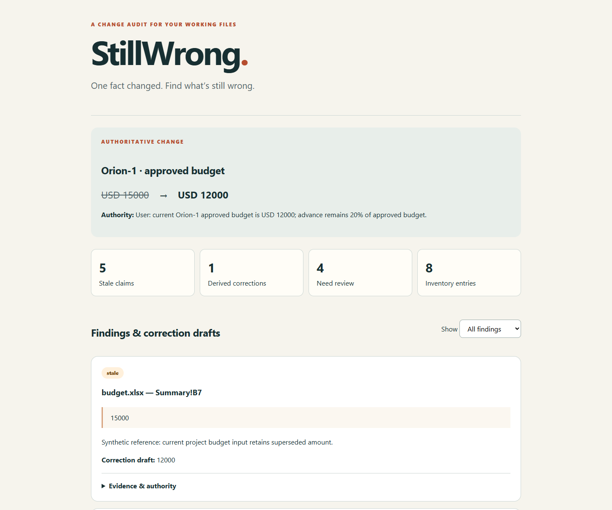

<p align="center"></p>

<p align="center"><b>A free, MIT-licensed Agent Skill by <a href="https://github.com/marufahmedlimon">Maruf Ahmed Limon</a></b><br>Evidence-linked correction drafts for mixed project files. Originals stay unchanged.</p>

<p align="center"><a href="#quick-start">Quick start</a> · <a href="evals/RESULTS.md">Verification</a> · <a href="LICENSE">MIT License</a></p>

## A small change. A long paper trail.

Your client reduces the budget. You update the spreadsheet. The proposal, slides
and payment schedule still use yesterday's number. **StillWrong follows an
authoritative fact change across your selected files** and drafts corrections.

> Use StillWrong on this folder. Orion's approved budget changed from USD 15,000
> to USD 12,000. Advance remains 20% of approved budget. My instruction is the
> authority. Find what needs updating; preserve the originals.

| In the files | What you receive |
| --- | --- |
| Proposal still says USD 15,000 | Source quote, exact location and replacement draft |
| Advance still says USD 3,000 | Explicit calculation: 12,000 × 20% = 2,400 |
| Last year's minutes say USD 15,000 | A preserved historical reference |
| Another department's budget matches | `needs_review`, rather than assumed equivalence |
| Locked PDF or embedded chart | Visible coverage gap |

**Outputs:** standalone HTML with filters, literal Markdown, and versioned JSON
with findings, source-relative evidence and coverage. View the [illustration](examples/demo-report/report.md)
or download/open [report.html](examples/demo-report/report.html) locally. It uses
reference findings, **not a measured detection result**.

<details><summary>Preview the report</summary>



</details>

## Quick start

Requires a skill-capable agent with local file/shell access and **Python 3.11+**.
The host AI judges meaning; Python extracts, validates evidence/arithmetic and
renders reports. This is not a standalone AI.

After the repository is public, paste into your agent:

```text
Install StillWrong from https://github.com/marufahmedlimon/stillwrong.
Read INSTALL.md, install the complete skills/stillwrong folder for this agent,
and verify it with the bundled example. Do not edit unrelated settings.
```

Or use the [Skills CLI](https://github.com/vercel-labs/skills) with Node.js/npm:

```sh
npx skills add marufahmedlimon/stillwrong --skill stillwrong
```

No Node? Copy the whole `skills/stillwrong` directory into your agent's supported
skill location. See [INSTALL.md](INSTALL.md). The URL is the intended publishing
destination, not a claim that an unpublished repository is already reachable.

### First run from a source checkout

```sh
python skills/stillwrong/scripts/setup.py
```

Setup creates an isolated `.venv`, installs free format libraries and prints its
interpreter. Use that interpreter in place of `python` below. Global packages
are unchanged. Initial setup needs internet; local helpers make no network calls.

```sh
python skills/stillwrong/scripts/stillwrong.py extract "YOUR_FOLDER" --out "runs/review-01"
```

The agent reads `evidence.json`, reviews your change and writes `findings.json`
using the [contract](skills/stillwrong/references/contract.md). The helper does
**not** automatically decide which claims are stale.

```sh
python skills/stillwrong/scripts/stillwrong.py validate runs/review-01/evidence.json runs/review-01/findings.json
python skills/stillwrong/scripts/stillwrong.py render runs/review-01/evidence.json runs/review-01/findings.json
```

Output must be outside the selected source folder. Existing reports require
`--overwrite`; source overlap and linked destinations remain prohibited.
Source changes after extraction invalidate the evidence.

## Supported files

| Format | Locator | Boundary |
| --- | --- | --- |
| TXT / Markdown | Line | UTF-8 text |
| CSV | Record / column | Literal cell text |
| Digital PDF | Page / quote | No OCR or visual-layout certification |
| DOCX | Paragraph / table / header / footer | No invented page numbers |
| PPTX | Slide / shape / table | Grouped text supported; visuals not interpreted |
| XLSX | Sheet / cell | Formula text and labelled caches; no recalculation |

History, different currencies/periods and unrelated projects are not errors just
because numbers match. Arithmetic needs explicit relationships and decimal-string
operands. Uncertain scope, complex formulas, FX and unstated date rules stay
`needs_review`. Scans, chart/image text, SmartArt, embedded objects, Word
fields/revisions and PowerPoint masters/notes are outside v1's semantic review.

Work limits: 500 inventory entries, 25 MiB/file, 100 MiB expanded Office archive,
500 PDF pages, 100,000 cells/worksheet, 1,000,000 extracted characters. Split
larger selections. These limits are not an OS sandbox for hostile documents.

## Verification

See [executed checks and limitations](evals/RESULTS.md). Tests cover source
preservation, evidence tampering, report injection, special formulas and limits.

```sh
python -m unittest discover -s tests -v
python scripts/build_demo.py
```

Six synthetic packs cover budgets, launch date, price, owner, quantity and
currency formatting: 24 labelled targets and 24 negative controls. Keep the answer key and
prefilled reports hidden from evaluating agents. [Evaluation protocol](evals/PROTOCOL.md)
defines the baseline and scoring limits. No overall precision/recall threshold
or universal host compatibility is claimed. CI is configured for Windows, macOS
and Linux; configuration is not proof of completed CI runs.

## Privacy

No telemetry, separate AI API key, server or background watcher. **The host AI
receives extracted content** under its own policies; existing host charges apply.
Reports can contain private quotes. Extraction never saves source documents.
Reports are correction proposals, not automatic edits or a clean bill of health.

## Author & community

Created and maintained by **[Maruf Ahmed Limon](https://github.com/marufahmedlimon)**.
Original code/docs: [MIT](LICENSE), copyright 2026 Maruf Ahmed Limon. Dependencies
retain their own licenses.

[Contributing](CONTRIBUTING.md) · [Security](SECURITY.md) · [Changelog](CHANGELOG.md)

Related work: [Spec Forge propagate](https://github.com/tercel/spec-forge/blob/main/skills/propagate/SKILL.md)
and [reviewing-document-set](https://github.com/bm629/agent-skills/blob/main/skills/reviewing-document-set/SKILL.md).
StillWrong focuses on everyday mixed files and precise evidence; it does not
claim to have invented consistency checking.
